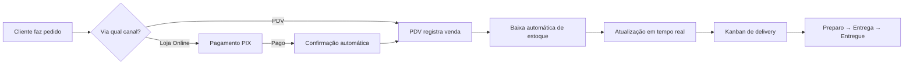

# 🍕 PizzaStockAI

**Sistema Inteligente de Gestão para Pizzarias**

Estoque • PDV • Delivery • PIX • Loja Online • Financeiro • Business Intelligence • IA


> *"Forno aceso, números na mão."* Menos desperdício, nenhuma ruptura no pico e compras guiadas por previsão de demanda.

Uma plataforma completa para gerenciamento de pizzarias, integrando estoque, produção, vendas, delivery, financeiro e inteligência de negócios em uma única solução moderna e escalável.

---

## 🚀 Demo e Apresentação

### 🌐 Demo Online v1 teste

[Acesse a Loja Online](https://project-guidebook.vercel.app/loja)

### 🎥 Vídeo Demonstração v2 OFC 

[Assista no Instagram](https://www.instagram.com/paulo_roberto_dev/reel/DeqPM3-BzjU/)

### 📦 Pedido Real Validado

| Detalhe | Valor |
|---|---|
| **Ficha** | #121 |
| **Data** | 16/10/2026 |
| **Valor** | R$ 66,90 |
| **Pagamento** | PIX QR Code válido |

---

## Sumário

- [🚀 Demo e Apresentação](#-demo-e-apresentação)
- [📖 Visão geral](#visão-geral)
- [🎯 Problema Resolvido](#problema-resolvido)
- [📈 Evolução do Projeto](#evolução-do-projeto)
- [✨ Funcionalidades](#funcionalidades)
- [💳 Pagamento PIX](#pagamento-pix)
- [🔍 Rastreamento de Pedidos](#rastreamento-de-pedidos)
- [📊 Métricas do Projeto](#métricas-do-projeto)
- [🤝 Casos de Uso](#casos-de-uso)
- [⭐ Diferenciais Competitivos](#diferenciais-competitivos)
- [🏗 Stack tecnológica](#stack-tecnológica)
- [🏗 Arquitetura](#arquitetura)
- [🔄 Fluxo de Pedido](#fluxo-de-pedido)
- [📁 Rotas da aplicação](#rotas-da-aplicação)
- [📁 Modelo de dados](#modelo-de-dados)
- [🔒 Perfis e permissões](#perfis-e-permissões)
- [🤖 Previsão de demanda](#previsão-de-demanda)
- [🛠 Primeiros passos](#primeiros-passos)
- [📜 Scripts disponíveis](#scripts-disponíveis)
- [📁 Estrutura de pastas](#estrutura-de-pastas)
- [🎨 Design system](#design-system)
- [🚀 Build e deploy](#build-e-deploy)
- [📝 Convenções de código](#convenções-de-código)
- [🛣 Roadmap](#roadmap)
- [👨‍💻 Equipe](#equipe)
- [🤝 Agradecimentos](#agradecimentos)
- [📜 Licença](#licença)

---

## 📖 Visão geral

O PizzaStockAI nasceu para resolver um dos maiores problemas enfrentados por pizzarias: **a falta de integração entre estoque, vendas, produção, delivery e financeiro**.

Muitos estabelecimentos utilizam planilhas, anotações manuais e sistemas isolados, criando retrabalho, desperdícios e perda de lucratividade.

O projeto centraliza toda a operação em uma única plataforma web full-stack (SSR), permitindo acompanhamento em tempo real das atividades da empresa:

- controla **ingredientes**, validade e estoque mínimo;
- calcula o **custo e a margem** de cada produto a partir da ficha técnica;
- registra vendas de **balcão e delivery** com baixa automática de insumos;
- acompanha pedidos em um **quadro kanban** de delivery com atualizações em tempo real;
- apresenta **indicadores financeiros** (faturamento, CMV, lucro, ticket médio);
- sugere **compras** com base em previsão de demanda calculada sobre o histórico de vendas.

---

## 🎯 Problema Resolvido

### ❌ Antes

- ❌ Controle manual de estoque
- ❌ Falta de visão financeira
- ❌ Perda de insumos por validade
- ❌ Ausência de previsões de compra
- ❌ Delivery desconectado do sistema
- ❌ Processos lentos e suscetíveis a erros

### ✅ Depois

- ✅ Operação centralizada
- ✅ Estoque atualizado automaticamente
- ✅ Delivery integrado em tempo real
- ✅ Pagamento PIX com QR Code dinâmico
- ✅ Controle financeiro completo
- ✅ Inteligência para compras
- ✅ Indicadores para tomada de decisão

---

## 📈 Evolução do Projeto

### Versão 1.0

| | |
|---|---|
| **Stack** | Python, SQLAlchemy, SQLite/PostgreSQL, Machine Learning |
| **Limitações** | Comunicação não era em tempo real, PDV apresentava gargalos sob carga, fluxo de delivery dependia de atualizações manuais |

### Versão 2.0 (Atual)

| | |
|---|---|
| **Stack** | React 19, TypeScript, Supabase, PostgreSQL, Realtime, TanStack Query, TanStack Router |
| **Melhorias** | ✅ Atualizações em tempo real, ✅ Melhor experiência do usuário, ✅ Maior desempenho, ✅ Delivery conectado ao painel administrativo, ✅ Sistema preparado para escalabilidade, ✅ Arquitetura orientada a eventos, ✅ Pagamento PIX integrado, ✅ Loja Online completa |

## ✨ Funcionalidades

### 🛒 PDV Inteligente

- Venda Balcão e Venda Delivery
- Carrinho integrado com aplicação de cupons
- Cálculo automático e taxa de entrega
- Impressão térmica 80mm
- Baixa automática do estoque
- Finalização via função atômica no banco (`registrar_venda`)

**Cupom Exemplo:** `BEMVINDO15`

---

### 🛒 Loja Online

**Experiência do Cliente:**
- Catálogo completo com fotos e descrições
- Carrinho de compras interativo
- Formulário de dados para entrega
- Redirecionamento automático para página de pagamento
- Horário de funcionamento exibido em tempo real

**Fluxo Completo:**
```
Montar Carrinho → Inserir Dados → Finalizar Pedido → Pagar via PIX
```

### 🚚 Delivery Online

**Área do Cliente:**
- Link público para pedidos
- Catálogo online com carrinho de compras
- Finalização do pedido com pagamento PIX
- Rastreamento em tempo real via código do pedido

**Gestão de Pedidos:**
- Atualização em tempo real com notificação sonora e alertas visuais
- Controle completo do fluxo com quadro Kanban
- Sincronização automática entre Loja Online e PDV

```
Novos Pedidos → Em Preparo → Saiu para Entrega → Entregue
```

---

### 💳 Pagamento PIX

**PIX Estático (Fallback):**
- Geração automática do QR Code PIX EMV conforme padrão do Banco Central
- Valor fixo da transação no código
- TXID único para rastreamento de cada pagamento
- CRC16-CCITT válido para aceitação pelos apps bancários

**PIX Dinâmico via Enviare (Opcional):**
- Integração com API Enviare para cobranças PIX dinâmicas
- Webhook para confirmação automática de pagamento
- Fallback automático para PIX estático se a API estiver indisponível
- Configuração via variáveis de ambiente (`ENVIARE_API_KEY`, `ENVIARE_MERCHANT_ID`)

**Timer de Pagamento:**
- Tempo limite de 15 minutos para pagamento
- Expiração automática de pedidos não pagos
- Timer regressivo visual (verde → amarelo → vermelho)
- Verificação em tempo real do status de expiração

**Modal de Pagamento:**
- Botão "Copiar código PIX" com feedback visual
- Toggle para mostrar/ocultar o BR Code completo
- Instruções passo a passo de como pagar
- Dados sensíveis mascarados na tela (chave PIX e telefone)

**Confirmação Automática:**
- Função `confirmar_pagamento_online` vincula pedido online ao PDV
- Baixa automática de estoque ao confirmar pagamento
- Registro de auditoria na tabela `pagamentos_online`
- Criação automática de venda no sistema

**Impressão Térmica:**
- QR Code no cupom para pagamento rápido
- Seção de taxas fiscais (ICMS, PIS, COFINS, ISS)
- Beneficiário exibido como "PizzaStockAI"
- Chave PIX e telefone mascarados para segurança

**Segurança:**
- Nome completo protegido; exibição usa marca da loja
- Chave PIX mascarada: `***.067.907-**`
- Telefone mascarado: `(21) 99319-****`
- QR Code contém dados completos para leitura bancária

---

### 📦 Gestão de Estoque

- Cadastro de produtos com controle de quantidade
- Custo unitário e data de validade
- Estoque mínimo com alertas automáticos
- Entrada de mercadoria e busca

**Indicadores:**
```
Valor em Estoque: R$ 1.180,03
Alerta: Manjericão vence em 1 dia
```

---

### 🍕 Gestão de Cardápio

**Produtos:** Pizzas, Bebidas, Combos, Adicionais

**Ficha Técnica:** Cada item possui ingredientes, quantidades, custos e margem de lucro.

**Exemplo:**
```
Pizza Calabresa
Custo: R$ 12,37
Margem: 79%
```

---

### 💰 Financeiro

- Controle de receitas e despesas
- Fluxo de caixa com períodos de 7, 30 e 90 dias
- Relatórios com exportação CSV

**Indicadores:**
```
Faturamento: R$ 85.975,20
Custos:      R$ 23.143,74
Lucro:       R$ 58.337,46
Ticket Médio: R$ 110,49
```

---

### 📊 Business Intelligence

Dashboards para análise operacional:

- Faturamento e lucro por período
- Ticket médio e vendas por período
- Produtos mais vendidos
- Gráficos, indicadores e relatórios
- Exportação de dados

---

### 🤖 Inteligência de Compras

O sistema utiliza dados históricos para estimar demanda futura e sugerir compras.

**Exemplo:**
```
Mozzarella em estoque: 21,05kg
Consumo previsto:      52,71kg
Sugestão:              Comprar 33,8kg
Investimento estimado: R$ 1.488,59
```

---

### 📋 Resumo dos Módulos

| Módulo | Descrição |
|---|---|
| **Central (Dashboard)** | Faturamento e lucro do dia, deliveries em aberto, alertas de estoque, gráfico de 14 dias e ranking dos 5 produtos mais vendidos (30 dias). |
| **PDV** | Montagem de pedido por toque, alternância Balcão/Delivery, cupom de desconto, taxa de entrega automática e finalização via função atômica no banco (`registrar_venda`). |
| **Loja Online** | Catálogo público com fotos, carrinho interativo, formulário de entrega e redirecionamento para pagamento PIX. |
| **Pagamento PIX** | QR Code EMV válido, timer de 5 minutos, botão copiar código, dados mascarados e taxas fiscais no cupom. |
| **Delivery** | Quadro com colunas *Novos → Em preparo → Saiu para entrega → Entregues*, atribuição de motoboy e cancelamento. Exibe as últimas 48h. |
| **Estoque** | CRUD de ingredientes, busca, entrada de mercadoria, destaque de itens abaixo do mínimo e vencidos, e valor total em estoque. |
| **Cardápio** | Cadastro de produtos com categoria, preço, disponibilidade e **ficha técnica** (receita). Mostra custo e margem (alerta visual abaixo de 30%). |
| **Financeiro** | Períodos de 7, 30 e 90 dias, faturamento, custo, lucro, margem, ticket médio, descontos, gráfico faturamento × lucro e **exportação CSV**. |
| **Previsões** | Projeção de pedidos e faturamento para 7 ou 14 dias, gráfico real × previsto e lista de compras sugerida com valor estimado. |
| **Alertas** | Agrupa ingredientes vencidos, vencendo em até 3 dias, zerados e abaixo do mínimo. |
| **Configurações** | Horário de funcionamento, taxa de entrega, som de alerta para novos deliveries, gestão de motoboys e cupons. |
| **Autenticação** | E-mail/senha e login com Google. O primeiro usuário cadastrado se torna administrador. |

---

## 📊 Métricas do Projeto

| Métrica | Valor |
|---|---|
| **PDV** | < 1,5 segundos |
| **Atualização Realtime** | < 500ms |
| **Arquitetura** | Cloud Native |
| **Banco de Dados** | PostgreSQL |
| **Autenticação** | Google OAuth |
| **Módulos** | Estoque, PDV, Delivery, Financeiro, BI, IA |

---

## 🤝 Casos de Uso

| Perfil | Ações |
|---|---|
| **Cliente** | Fazer pedidos online, acompanhar status, aplicar cupons |
| **Atendente** | Registrar vendas, emitir comprovantes, consultar pedidos |
| **Gerente** | Controlar estoque, visualizar BI, gerar relatórios |
| **Motoboy** | Receber entregas, atualizar status de pedidos |

---

## ⭐ Diferenciais Competitivos

- ✅ Estoque integrado ao PDV
- ✅ Delivery em tempo real
- ✅ Pagamento PIX com QR Code válido
- ✅ Loja Online completa
- ✅ Controle de validade
- ✅ Sugestão inteligente de compras
- ✅ Financeiro integrado
- ✅ Business Intelligence
- ✅ Impressão térmica 80mm
- ✅ Login Google
- ✅ Arquitetura moderna
- ✅ Banco de dados em nuvem

## 🏗 Stack tecnológica

### Frontend

- [TanStack Start](https://tanstack.com/start) (SSR) + [TanStack Router](https://tanstack.com/router) com rotas baseadas em arquivos
- [TanStack Query](https://tanstack.com/query) (`useSuspenseQuery` + `ensureQueryData` nos loaders)
- React 19, TypeScript 5.8 (modo `strict` com flags adicionais)
- Tailwind CSS 4 + `tw-animate-css`
- Componentes baseados em [Radix UI](https://www.radix-ui.com/) (padrão shadcn/ui)
- `lucide-react`, `sonner`, `cmdk`, `vaul`
- Gráficos com [Recharts](https://recharts.org/)
- Formulários: `react-hook-form` + `zod`
- QR Code: `qrcode` para geração de imagens PIX
- Supabase Realtime para atualizações em tempo real

### Backend

- [Supabase](https://supabase.com/) (Auth, Postgres, RPC, Realtime)
- `@supabase/supabase-js`
- `@lovable.dev/cloud-auth-js` para OAuth (Google)
- Nitro como servidor (alvo padrão: Cloudflare no build)
- Integração Enviare para PIX dinâmico (opcional)
- Supabase Edge Functions para webhooks

### Qualidade

- Vitest + Testing Library + jsdom
- ESLint 9 + Prettier

## Arquitetura

```
Navegador ──► TanStack Start (SSR) ──► Nitro
                    │
                    ├── Roteamento por arquivos (src/routes)
                    ├── Loaders pré-carregam dados no QueryClient
                    └── Supabase (Auth + Postgres + RPC)
```

Pontos relevantes:

- **Roteamento por arquivos**: `routeTree.gen.ts` é gerado automaticamente pelo plugin do TanStack Router. **Não edite manualmente.**
- **Contexto do router**: o `QueryClient` é injetado no `context` do router (`src/router.tsx`), permitindo que cada rota use `context.queryClient.ensureQueryData(...)` no `loader`.
- **Rotas protegidas**: o layout `_authenticated` roda com `ssr: false` e, em `beforeLoad`, consulta `supabase.auth.getUser()`; sem usuário, redireciona para `/auth`. Todas as páginas internas são renderizadas dentro do `AppShell`.
- **Servidor**: `vite.config.ts` usa `@lovable.dev/vite-tanstack-config`, que já inclui `tanstackStart`, `viteReact`, `tailwindcss`, `tsconfig-paths`, `nitro` e injeção de variáveis `VITE_*`. A entrada do servidor é redirecionada para `src/server.ts` (wrapper de erros de SSR).
- **Regras de negócio críticas no banco**: o registro de venda é feito pela função RPC `registrar_venda`, que valida e baixa insumos de forma atômica.
- **Tratamento de erros**: cada rota define `errorComponent: RouteError`.
- **SEO**: cada rota declara `head()` com `title`, `description` e tags Open Graph.

---

## 🔄 Fluxo de Pedido



1. **Cliente** faz o pedido via PDV ou Loja Online
2. **Loja Online**: Cliente paga via PIX (estático ou dinâmico via Enviare)
3. **Confirmação**: Pagamento confirmado automaticamente via webhook ou manualmente
4. **Sistema**: Registra a venda e vincula ao pedido online
5. **Estoque**: Baixa automática conforme ficha técnica
6. **Painel**: Atualização em tempo real via Supabase Realtime
7. **Equipe**: Acompanha o fluxo no Kanban de delivery
8. **Cliente**: Rastreia o pedido em tempo real via código
9. **Financeiro**: Registra receita e custo automaticamente

---

## 📁 Rotas da aplicação

| Caminho | Acesso | Descrição |
|---|---|---|
| `/` | Público | Landing page |
| `/auth` | Público | Login, cadastro e Google OAuth |
| `/loja` | Público | Loja Online - catálogo e carrinho |
| `/pagamento/$vendaId` | Público | Página de pagamento PIX com QR Code |
| `/rastrear` | Público | Rastreamento de pedido por código |
| `/dashboard` | Autenticado | Central |
| `/pdv` | Autenticado | Ponto de venda |
| `/delivery` | Autenticado | Quadro de pedidos |
| `/estoque` | Autenticado | Ingredientes |
| `/cardapio` | Autenticado | Produtos e fichas técnicas |
| `/financeiro` | Autenticado | Resultados financeiros |
| `/previsoes` | Autenticado | Previsão e compras |
| `/alertas` | Autenticado | Alertas de estoque |
| `/config` | Autenticado | Configurações da loja |

## 🔍 Rastreamento de Pedidos

Os clientes podem rastrear seus pedidos em tempo real através da página `/rastrear`:

**Funcionalidades:**
- Busca por código do pedido (token único)
- Timeline visual do status do pedido
- Atualização automática via Supabase Realtime
- Exibição de informações do cliente, endereço e itens
- Cupom fiscal/impressão do pedido
- Notificações de status em tempo real

**Fluxo de Status:**
```
Aguardando Pagamento → Pago → Em Preparação → Saiu para Entrega → Entregue
```

**Tecnologia:**
- Supabase Realtime para atualizações instantâneas
- Polling de fallback a cada 10 segundos
- Integração com sistema de pagamentos PIX

---

## 📁 Modelo de dados

Tabelas e funções utilizadas pelo código da aplicação (Supabase/Postgres):

| Tabela | Uso |
|---|---|
| `ingredientes` | `nome`, `unidade`, `quantidade`, `estoque_minimo`, `custo_unitario`, `validade` |
| `produtos` | `nome`, `categoria`, `preco`, `descricao`, `ativo` |
| `receitas` | Ficha técnica: `produto_id`, `ingrediente_id`, `quantidade` |
| `vendas` | `numero`, `tipo` (balcão/delivery/online), `status`, `cliente`, `telefone`, `endereco`, `motoboy_id`, `subtotal`, `desconto`, `taxa_entrega`, `total`, `custo`, `lucro`, `created_at` |
| `venda_itens` | Itens da venda: `produto_id`, `nome`, `quantidade` |
| `pedidos_online` | Pedidos da Loja Online: `cliente`, `telefone`, `endereco`, `itens`, `status`, `status_pagamento`, `expires_at`, `venda_id` |
| `pagamentos_online` | Auditoria de pagamentos: `pedido_id`, `transaction_id`, `status`, `metodo`, `valor` |
| `motoboys` | `nome`, `telefone`, `ativo` |
| `cupons` | `codigo`, `percentual`, `ativo` |
| `loja_config` | Linha única (`id = 1`): `abre`, `fecha`, `taxa_entrega`, `som_alerta` |

**Funções RPC:**
- `registrar_venda(_itens, _tipo, _cliente?, _telefone?, _endereco?, _cupom?)` - Registra venda no PDV
- `confirmar_pagamento_online(_pedido_id)` - Confirma pagamento e vincula pedido online ao PDV
- `expirar_pedido_online(_token)` - Cancela pedido expirado
- `verificar_expiracao_pedido(_token)` - Verifica se pedido expirou
- `listar_pedidos_com_timer()` - Lista pedidos aguardando pagamento com tempo restante

**Status de pedido:** `novo` → `preparo` → `saiu` → `entregue` (ou `cancelado`).
**Status de pagamento:** `aguardando` → `pago` → `expirado`.

> As migrações SQL não fazem parte dos arquivos analisados. Mantenha-as versionadas no repositório (por exemplo em `supabase/migrations`) e documente aqui o processo de criação do schema.

## 🔒 Perfis e permissões

Existem três perfis: **administrador**, **gerente** e **atendente**. O hook `useRole` expõe `isManager`, usado para restringir ações sensíveis:

| Ação | Atendente | Gerente / Admin |
|---|:---:|:---:|
| Visualizar estoque e cardápio | ✅ | ✅ |
| Registrar entrada de estoque | ✅ | ✅ |
| Criar, editar e excluir ingredientes | ❌ | ✅ |
| Criar e editar produtos e fichas técnicas | ❌ | ✅ |

O **primeiro usuário cadastrado vira administrador**. Recomenda-se reforçar as permissões também com RLS (Row Level Security) no Supabase, pois a checagem na interface não substitui a do banco.

## 🤖 Previsão de demanda

O módulo `src/lib/forecast.ts` aplica **regressão linear** sobre a série diária dos últimos 30 dias para projetar, em um horizonte de 7 ou 14 dias:

1. número de pedidos;
2. faturamento;
3. consumo diário de cada ingrediente (vendas × ficha técnica).

A função `sugestaoCompra` combina o consumo previsto, o estoque atual e o estoque mínimo para sugerir a quantidade a comprar, e a lista é ordenada pelo valor estimado (custo unitário × quantidade).

## 🛠 Primeiros passos

### Pré-requisitos

- Node.js 20+ (recomendado 22 LTS)
- npm (ou outro gerenciador compatível)
- Um projeto Supabase com o schema descrito acima

### Instalação

```bash
git clone <url-do-repositorio>
cd <pasta-do-projeto>
npm install
```

### Variáveis de ambiente

Crie um arquivo `.env` na raiz com as credenciais do seu projeto Supabase. O `@lovable.dev/vite-tanstack-config` injeta automaticamente variáveis com prefixo `VITE_`. Os nomes costumam ser:

```env
VITE_SUPABASE_URL=https://<seu-projeto>.supabase.co
VITE_SUPABASE_PUBLISHABLE_KEY=<chave-publica>
```

> Confirme os nomes exatos em `src/integrations/supabase/client.ts`. Nunca versione chaves secretas.

Para PIX dinâmico via Enviare (opcional):

```env
ENVIARE_API_KEY=<chave-api-enviare>
ENVIARE_MERCHANT_ID=<id-estabelecimento>
ENVIARE_WEBHOOK_SECRET=<segredo-hmac>
ENVIARE_WEBHOOK_URL=<url-webhook-edge-function>
```

### Executando em desenvolvimento

```bash
npm run dev
```

Acesse a URL exibida no terminal. Crie a primeira conta em `/auth` (ela será a administradora).

## 📜 Scripts disponíveis

| Script | Comando | Descrição |
|---|---|---|
| `dev` | `vite dev` | Servidor de desenvolvimento |
| `build` | `vite build` | Build de produção |
| `build:dev` | `vite build --mode development` | Build em modo desenvolvimento |
| `preview` | `vite preview` | Pré-visualização do build |
| `lint` | `eslint .` | Análise estática |
| `format` | `prettier --write .` | Formatação do código |
| `test` | `vitest run` | Executa os testes uma vez |
| `test:watch` | `vitest` | Testes em modo watch |

## 📁 Estrutura de pastas

```
.
├── src/
│   ├── routes/
│   │   ├── __root.tsx
│   │   ├── index.tsx              # Landing page
│   │   ├── auth.tsx               # Login / cadastro
│   │   ├── loja.tsx               # Loja Online
│   │   ├── rastrear.tsx           # Rastreamento de pedidos
│   │   ├── pagamento/$vendaId.tsx # Página de pagamento PIX
│   │   └── _authenticated/        # Rotas protegidas
│   │       ├── route.tsx          # Guard de autenticação + AppShell
│   │       ├── dashboard.tsx
│   │       ├── pdv.tsx
│   │       ├── delivery.tsx
│   │       ├── estoque.tsx
│   │       ├── cardapio.tsx
│   │       ├── financeiro.tsx
│   │       ├── previsoes.tsx
│   │       ├── alertas.tsx
│   │       └── config.tsx
│   ├── components/
│   │   ├── ui/                    # Componentes base (shadcn/Radix)
│   │   ├── ui-kit.tsx             # PageHeader, Panel, Stat, RouteError
│   │   ├── AppShell.tsx           # Layout autenticado
│   │   ├── NFCEPrint.tsx          # Cupom térmico com QR Code PIX
│   │   └── PixPaymentModal.tsx    # Modal de pagamento com timer e copiar código
│   ├── hooks/useRole.ts
│   ├── integrations/
│   │   ├── supabase/client.ts
│   │   └── lovable/index.ts
│   ├── lib/
│   │   ├── data.ts                # Queries, tipos e helpers (brl, num, dayKey...)
│   │   ├── forecast.ts            # Previsão e sugestão de compra
│   │   ├── pix.ts                 # Geração de payload PIX EMV QR Code
│   │   ├── enviare.ts             # Integração com API Enviare
│   │   └── online-order.ts        # Funções de pedido online
│   ├── components/
│   │   ├── OnlineOrderNFCE.tsx    # Cupom fiscal para pedidos online
│   │   ├── OnlineOrders.tsx       # Gestão de pedidos online no PDV
│   │   ├── OrderTracker.tsx       # Componente de rastreamento
│   │   └── OrderStatusBadge.tsx   # Badge de status do pedido
│   ├── supabase/
│   │   ├── migrations/            # Migrações SQL do banco
│   │   └── functions/             # Edge Functions (webhooks)
│   ├── router.tsx
│   ├── routeTree.gen.ts           # Gerado automaticamente
│   ├── server.ts
│   └── styles.css
├── vite.config.ts
├── tsconfig.json
└── package.json
```

> A árvore acima combina o que foi analisado diretamente com os caminhos referenciados pelos imports. Ajuste conforme o repositório real.

## 🎨 Design system

Tema escuro quente, inspirado em forno a lenha, definido em `src/styles.css` com tokens **OKLCH** e Tailwind 4 (`@theme inline`):

- **Tipografia:** *Fraunces* (títulos, serifada) e *Manrope* (texto)
- **Cores semânticas:** `primary`, `secondary`, `muted`, `accent`, `destructive`, `success`, `warning` e `ember`, mais paleta de gráficos (`chart-1…5`) e de sidebar
- **Utilitários customizados:** `bg-ember-gradient`, `bg-hearth` e `shadow-glow`
- **Raio base:** `0.75rem`

## 🚀 Build e deploy

```bash
npm run build
npm run preview
```

O build é feito pelo Nitro, e o alvo padrão definido pela configuração da Lovable é **Cloudflare**. Para outro provedor, ajuste o preset do Nitro em `vite.config.ts` via `defineConfig({ vite: { ... } })`. Lembre-se de configurar as variáveis de ambiente no provedor escolhido.

## 📝 Convenções de código

- TypeScript estrito, incluindo `noUncheckedIndexedAccess`, `exactOptionalPropertyTypes` e `noImplicitReturns`.
- Alias de importação `@/*` → `src/*`.
- Dados sempre carregados no `loader` (`ensureQueryData`) e lidos no componente com `useSuspenseQuery`.
- Após mutações, invalide as `queryKey` correspondentes (`["vendas"]`, `["ingredientes"]`, etc.).
- Não edite `routeTree.gen.ts`.
- Antes de commitar: `npm run lint`, `npm run format` e `npm run test`.

## 🛣 Roadmap

### ✅ Concluído

- Estoque
- PDV
- Loja Online
- Pagamento PIX (QR Code EMV)
- PIX Dinâmico via Enviare (opcional)
- Confirmação automática de pagamento
- Timer de expiração de pagamento (15 min)
- Rastreamento de pedidos online
- Sincronização Loja Online → PDV
- Delivery Online
- Kanban Realtime
- Financeiro
- Dashboard BI
- Login Google
- Impressão 80mm
- Inteligência de Compras
- Taxas fiscais no cupom

### 🚧 Em Desenvolvimento

- WhatsApp Business
- Impressão automática sem diálogo
- Relatórios avançados
- Dashboard de pagamentos online

### 🔮 Futuras Versões

- Aplicativo Android
- Aplicativo iOS
- Multiunidades
- Franquias
- QR Code para mesas
- Integração iFood
- Integração Mercado Pago

---

## 👨‍💻 Equipe DEV.CODE

**Projeto desenvolvido durante o Programa Serratec**

### Desenvolvedores

- Paulo Roberto Silva de Oliveira Júnior
- João
- Gabriel
- João Daniel
- Douglas Lopes
- Samuel

### 🎓 Orientação

**Professor Rodrigo Braga**

### 🏫 Instituições


- UNIFESO

---

## 🤝 Agradecimentos

Agradecemos ao **Serratec**, ao **SEBRAE**, ao **UNIFESO** e ao **Professor Rodrigo Braga** pela oportunidade, apoio, orientação e incentivo ao desenvolvimento deste projeto.

O PizzaStockAI representa a união entre **tecnologia, inovação e empreendedorismo**, aplicando conhecimentos de Arquitetura de Software, Desenvolvimento Full Stack, Banco de Dados, UX/UI e Inteligência de Negócios para solucionar desafios reais do mercado.

---

## 📜 Licença

**Privado - Todos os direitos reservados**
